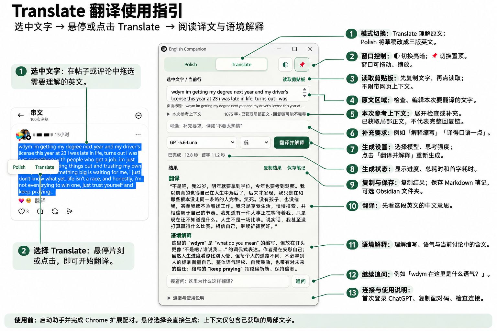
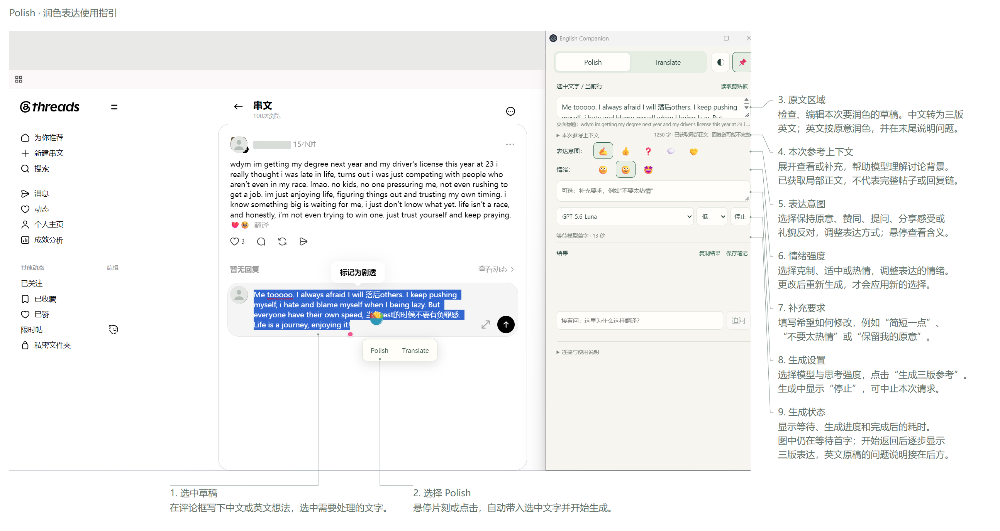
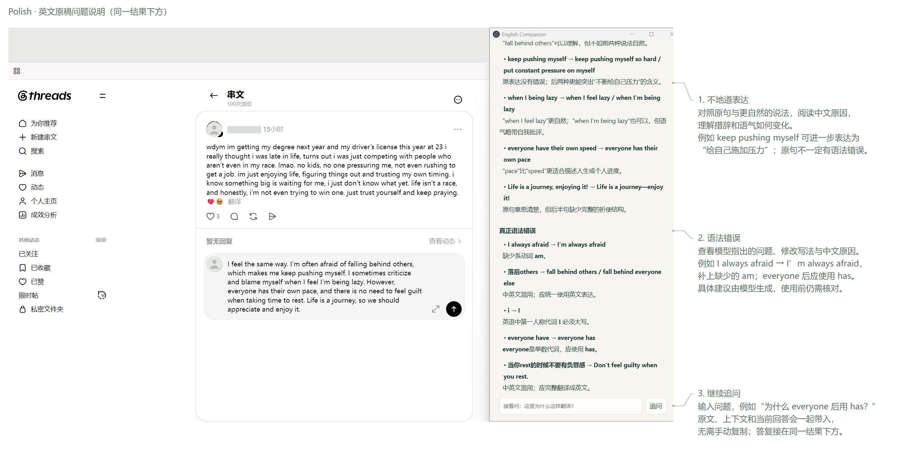

# English Companion

帮助脑子里有想法、却很难用英语组织出完整句子的人，在真实交流中练习表达。

English Companion 是一个运行在 Windows 上、配合 Chrome 使用的英语助手。读帖子时，用 **Translate** 理解内容；想回复时，先用中文或英文写下自己的想法，再用 **Polish** 获得三版自然的英文表达，并学习其中的修改。

当前版本：**0.3.1 试用版**。Quicker 是可选的快捷入口。

## 为什么做这个工具

我的雅思总分是 7.0，但口语只有 5.5，写作是 6.5。对我来说，英语输出仍然很弱：看懂一些内容，不代表能把自己的想法说出来。很多时候，我知道自己想表达什么，却组织不出一个完整的英语句子；勉强写出来，又不确定是不是自然的表达。

我想在 Threads、Reddit、Facebook 等平台参与讨论，而不是每次都因为不知道怎么回复而退出。所以，我做了 English Companion：先让自己能够参与交流，再通过比较原稿和修改后的表达，慢慢积累能自己说出来的句子。

我希望借助这个工具提升自己的英语思维和表达能力，也希望它能帮助有相似困扰的人。每一次想说却说不出来的时刻，都可以变成一次表达练习。

## 使用场景

### 看不懂别人的帖子或评论：Translate

在网页上选中文字，将鼠标停留在浮出的 **Translate** 上，或直接点击它。助手会在独立窗口中显示中文译义，以及结合已获取上下文的简短解释，例如指代、语气或这句话在讨论中的意思。

如果仍然不理解，可以在结果下方追问，例如「这里是在讽刺吗？」或「这个词为什么这样翻译？」。

展开「本次参考上下文」，可以查看提取的局部正文、补充原帖。只有页面标题时，界面会明确标注。



[查看完整翻译指引图](docs/guides/translate.png)

### 想回复但写不出来：Polish

先在网页评论框中写下自己的想法。中文、英文都可以，不必一开始就写得完美。选中草稿，选择 **Polish**，即可获得三版参考：

| 版本 | 表达风格 |
| --- | --- |
| 自然口语 | 日常交流中比较自然的表达 |
| 社交轻松 | 更轻松、适合社媒互动的表达 |
| 礼貌稳重 | 更克制、措辞更稳妥的表达 |

- **中文草稿**：按你的原意翻译成三版英文。
- **英文草稿**：按原意润色成三版，并分别指出不地道表达和语法错误，给出修改建议及中文原因。

你可以调整表达意图和情绪，也可以补充「不要太热情」「简短一点」等要求。先写下自己想说的内容，再调整表达方式。

下图展示 Polish 的输入与设置。截图正在等待模型首字，结果区尚未显示三版表达。



[查看完整润色表达指引图](docs/guides/polish-input.png)

挑选符合自己意思的表达，复制到评论框后发布。

### 把参考表达变成自己的表达

可以先尝试用英文写，再对照修改，重点记住一两处自己经常卡住的表达。完全写不出来时，先用中文写也没关系。

英文原稿的三版表达后，会继续列出「不地道表达」和「语法错误」，按「原文 → 修改建议 → 中文原因」说明。下图是**同一窗口向下滚动后的结果内容**，不是另一个功能页面。风格建议不代表原句一定有语法错误；具体分析由模型生成，可以结合原意判断，也可以在下方继续追问。



[查看完整原稿问题说明图](docs/guides/polish-explanation.png)

想保留的内容可以点击「保存笔记」，将原文、上下文与结果保存为 Markdown 文件。可以选择 Obsidian Vault 中的文件夹；目前没有专用的 Obsidian 插件或自动同步功能。

## 功能与操作

| 功能 | 使用方式 |
| --- | --- |
| 网页划词 | 选中文字后悬停或点击 Polish / Translate；悬停时间可在扩展设置中调整 |
| 快捷键取词 | Chrome 中按 `Ctrl + Shift + Y`，按 Polish 处理选区；没有选区时尝试读取输入光标所在的逻辑行 |
| 其他入口 | 点击扩展图标，或使用网页右键菜单 |
| 手动输入 | 在助手的原文框中输入或粘贴文字 |
| 读取剪贴板 | 先 `Ctrl + C`，再点击「读取剪贴板」；按当前模式生成，不会附带网页上下文 |
| 表达意图 | ✍️ 保持原意、👍 表达赞同、❓ 提出问题、💬 分享感受、🤝 礼貌反对 |
| 情绪强度 | 😐 克制、🙂 适中、🤩 热情；悬停图标可查看含义 |
| 悬浮窗口 | 自由移动、拖动边缘缩放；右上角置顶默认关闭，开启后仍可移动和缩放 |
| 深色模式 | 点击右上角亮暗图标，切换助手窗口配色 |
| 模型与思考强度 | 在生成按钮旁选择，设置会记住；可用选项取决于当前账号 |
| 结果与追问 | 逐步显示结果，支持停止生成、复制结果、继续追问和保存笔记 |

「当前行」按换行符划分；部分富文本输入框按当前文本节点取词。要精确指定处理范围，直接选中文字。

## 首次使用

适用环境：**Windows 10/11 x64 + Chrome**。需要能访问 OpenAI 服务的网络，当前不支持离线翻译。

本工具通过 Codex 的 ChatGPT 登录能力调用模型，以作者的 Plus 使用场景开发，不要求填写 API Key。调用会消耗账号可用的 Codex 套餐额度；模型、额度与可用性以登录账号为准，可能与 ChatGPT 网页不同。

### 使用完整便携包

**目前便携包尚未上传到 GitHub Releases。「Download ZIP」下载的是源码，不能当作完整便携包直接运行。** 获得 `EnglishCompanion-0.3.1-win-x64.zip` 完整包后：

1. 完整解压到固定文件夹，例如 `D:\Tools\EnglishCompanion`，不要在 ZIP 内直接运行。
2. 双击 `Start.vbs`，打开助手。
3. 在底部展开「连接与使用说明」，点击「使用 ChatGPT 登录」，按提示登录自己的账号。
4. Chrome 打开 `chrome://extensions`，开启「开发者模式」，点击「加载已解压的扩展程序」，选择解压目录中的 `extension` 文件夹。
5. 在助手中点击「复制配对码」，打开扩展的设置页面，粘贴后点击「保存并测试连接」。
6. 刷新已打开的网页，选中文字，选择 **Translate** 或 **Polish**。

完整便携包包含运行程序，无需另装 Node.js、Electron 或 Codex CLI。使用时保持助手运行；关闭助手窗口会退出程序。

### 可选：接入 Quicker

在 Quicker 中添加运行程序入口，程序填写 `C:\Windows\System32\wscript.exe`，参数填写脚本完整路径，并加英文双引号：

- 启动助手：`"D:\Tools\EnglishCompanion\Start.vbs"`
- 网页取词：`"D:\Tools\EnglishCompanion\Quicker-Capture.vbs"`

请替换为自己电脑上的实际路径。取词前先启动助手，并让 Chrome 处于前台。取词入口发送 `Ctrl + Shift + Y`；若快捷键冲突，请检查 `chrome://extensions/shortcuts`。

目前提供脚本入口，尚未提供一键安装的 Quicker 动作包。

## 当前限制

- 社媒评论是主要场景。Threads、Reddit、Facebook、YouTube、X、Instagram 和 Discord 网页使用通用取词及部分页面识别，尚未逐个平台完成全面兼容性测试。
- 上下文仅包含已提取的局部文字，不会自动展开折叠评论，也不能读取图片或视频内容。剪贴板取词需要自行补充上下文。
- 普通博客使用网页划词翻译，暂无专用阅读视图。
- Chrome 内置 PDF 阅读器、浏览器设置页暂不支持此版取词。逐行聚焦、自动滚动、PDF 标注与导出尚未实现。
- 生成速度受网络、模型和思考强度影响。
- 长结果需要滚动查看；深色模式只改变助手窗口，不改变原网页。
- 当前为未签名的试用版，没有自动更新功能。更新步骤见 [在另一台电脑使用与更新](RELEASE-GUIDE.md)。

## 数据如何处理

用户触发取词后，Chrome 扩展把所选文字、页面标题、链接和提取到的附近文字发送给本机助手。生成时，这些内容会发送给 OpenAI；悬停选择也会直接触发生成。

划词选择后会自动生成。「本次参考上下文」支持查看和修改内容；需要先编辑再发送时，手动输入原文和上下文，再点击生成。

配对码用于连接本机助手，不是 ChatGPT 账号密钥。扩展不保存 ChatGPT 凭证；应用不自动保存取词历史，主动保存的笔记写入你选择的目录。Codex 自身与服务端的数据处理遵循相应设置和政策。

源码及便携包不应包含账号凭证、配对码、个人设置或 `.runtime` 目录。请勿直接压缩日常使用的整个安装目录分享给他人。

## 从源码运行与开发

需要 Windows、Node.js 22.12+，以及可使用 ChatGPT 登录的 Codex CLI。

```powershell
git clone https://github.com/chuan-iss/english-companion.git
cd english-companion
npm install
node node_modules/electron/install.js
npm start
```

如果 Codex 不在程序支持的默认查找位置，可以将环境变量 `EN_TOOL_CODEX` 设为 `codex.exe` 的完整路径。启动后仍需安装 Chrome 扩展并配对。

- `npm test`：运行提示词与 Markdown 渲染测试。
- `npm run probe`：检查真实账号连通性，会发出测试请求并消耗少量套餐额度。
- `python scripts/build-release.py`：构建完整包和更新包，需要本机已有脚本所需的运行程序。详见 [发布与更新说明](RELEASE-GUIDE.md)。

项目包含桌面应用 `app/`、Chrome 扩展 `extension/`、构建与验证脚本 `scripts/`、测试 `tests/`，以及 Quicker 可调用的 VBS 入口。第三方许可说明位于 `licenses/`。
